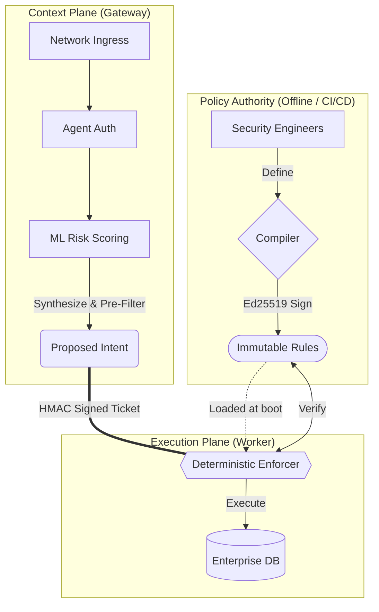

# Deterministic Enforcement Fabric
**Architectural Review — Trust Isolation Model**

---

## 1. The Core Philosophy

---

## 2. What This Is NOT
*This pattern defines semantic intent enforcement. It is strictly scoped to pre-execution determinism.*

- **Not replacing IAM:** Identity determines *who* connects. This determines *what* they execute.
- **Not replacing the API gateway:** Your API gateway handles rate-limiting and TLS. This handles deeply contextual, stateful intent checks.
- **Not a service mesh:** Service meshes route packets blindly. This parses payloads semantically.
- **Not an LLM safety tool:** We do not rely on prompt alignment, "system prompts", or fuzzy safety filters.
- **Not a compliance certification:** It is an architectural primitive that *enables* demonstrable compliance.

---

## 3. "If Gateway Is Fully Compromised" 
(The Control-Plane Compromise Scenario)

1. A vulnerable dependency or configuration error yields RCE on the Gateway process.
2. The attacker authenticates a malicious request to `DROP TABLE customers`.
3. The Gateway evaluates the intent, ignoring the policy, and appends `risk_score: 0`. It signs a valid HMAC IPC ticket and sends it to the Worker.
4. The Worker receives the ticket.
5. The Worker compares the ticket's intent against its *own independent copy* of the immutable, Ed25519-signed policy bundle.
6. The Worker mathematically rejects the intent as a policy violation.
7. **The execution never occurs.** The attacker holds the Gateway, but the database remains perfectly isolated.

---

## 4. What This Does NOT Protect Against
*Security requires honesty about boundaries.*

- **Host root compromise:** If an attacker gains `uid=0` (root) on the physical host, process segregation falls. (Requires hardware/confidential computing to mitigate).
- **Key Authority compromise:** If the offline Ed25519/KMS private key is stolen, the attacker can sign malicious rules as "valid".
- **Risk under-reporting:** If the Gateway is compromised and arbitrarily assigns a `risk_score` of `0` to a highly risky operation, the Worker will allow it *if* the operation is otherwise permitted by the baseline RBAC policy.
- **Bundle Rollback (Downgrade):** Currently permits loading a previously valid (but older) signed bundle. (Requires version-pinning to mitigate).
- **Insider Policy Abuse:** Security engineers with commit access to the Policy Authority can author deliberately malicious rules.

---

## 5. What Changes in Enterprise Deployment
*The pattern scales additively. No core architectural changes are required.*

- **Key Management:** Replace the local Ed25519 workflow with AWS KMS, HashiCorp Vault, or an HSM.
- **Network Transport:** Replace raw IPC mapping with mTLS over gRPC to physically distribute the Gateway and Worker across different Kubernetes clusters/VPCs.
- **Nonce State:** Replace the in-memory LRU Nonce Cache with a distributed Redis cluster for scaled-out Worker pools.
- **Privilege Separation:** Run the Worker as a heavily restricted IAM Service Account spanning only the targeted execution resources.
- **Artifact Distribution:** Distribute the `policy.bundle.json` automatically via an immutable artifact registry (e.g., OCI / Docker Hub).
